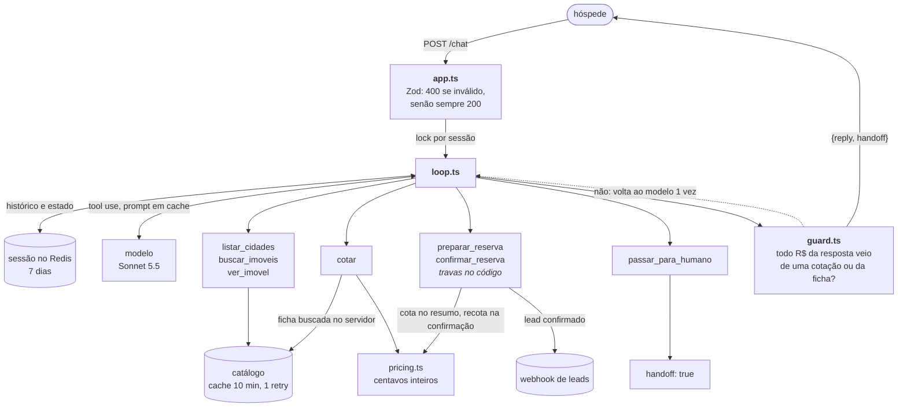

# agente-concierge

Agente concierge de hospedagem. Tira dúvidas só com o catálogo, cota estadias pela regra de preço,
registra o pedido de reserva (lead) depois da confirmação do hóspede e passa a conversa para um humano em
caso de reclamação, pedido de desconto, negociação ou assunto que não consegue resolver.

**Princípio:** o modelo conversa e escolhe a ferramenta; o código decide tudo o que é verificável.
Preço, datas, capacidade, confirmação, envio do lead e o formato dos valores não dependem do modelo.

**No ar:** `https://agente-concierge-seven.vercel.app` (Vercel, região `iad1`, sessões no Upstash Redis).

```bash
# use um session_id novo por conversa (ex.: a saída de uuidgen)
curl -s https://agente-concierge-seven.vercel.app/chat -H 'content-type: application/json' \
  -d '{"session_id":"3f1c2b9e-7a4d-4e8b-9c1a-5d6e7f8a9b0c","message":"Quanto fica o GRM-301 de 15/01/2027 a 18/01/2027 para 2 pessoas?"}'
```

## Contrato

```http
POST /chat
{"session_id": "abc-123", "message": "Quanto fica o GRM-301 de 15/01/2027 a 18/01/2027 para 2 pessoas?"}

200 OK
{"reply": "... O total fica R$ 2.156,00 ...", "handoff": false}
```

- A memória é por `session_id` (7 dias). O contrato não tem autenticação: o `session_id` é a credencial
  da conversa, então use um id imprevisível (UUID). `handoff: true` vale para a resposta em que o agente
  passou a conversa para um humano.
- `200` com `{reply, handoff}` para todo corpo válido, inclusive quando o modelo, o catálogo ou o Redis
  falham (resposta de contingência). `400` para corpo inválido. Mensagem acima de 4.000 caracteres ou corpo
  acima de 32 kB recebe `200` pedindo uma mensagem mais curta, sem chamar o modelo.
- Prazo único de 52 s desde a chegada da requisição, para tudo: lock, Redis, modelo, catálogo e webhook.
  Se algo escapar desse prazo, uma resposta de contingência sai aos 57 s, antes do corte da Vercel aos 60 s.
- `GET /health` para monitoramento.

## Como rodar

Requer Node 22 ou mais novo.

```bash
cp .env.example .env    # preencha ANTHROPIC_API_KEY e SEAZONE_TOKEN
npm install
npm run dev             # http://127.0.0.1:3000

curl -s 127.0.0.1:3000/chat -H 'content-type: application/json' \
  -d '{"session_id":"teste","message":"Quanto fica o GRM-301 de 15/01/2027 a 18/01/2027 para 2 pessoas?"}'
```

Sem Redis (`UPSTASH_REDIS_REST_URL`/`_TOKEN`, ou `KV_REST_API_URL`/`_TOKEN`, os nomes que a Vercel
injeta), as sessões ficam em memória (só para desenvolvimento).
Configuração inválida falha ao subir, não no meio de uma conversa. As variáveis opcionais (`MODELO`,
`ESFORCO`, `HOST`, `PORT`) estão no `.env.example`.

| Comando | O que faz |
|---|---|
| `npm run check` | Typecheck e testes unitários (sem rede, sem modelo) |
| `node --env-file=.env node_modules/.bin/vitest run test/session.redis.test.ts` | Sessão e lock contra o Redis real |
| `npm run evals -- --rodadas 2 --juiz` | Conversas reais contra o modelo; ver `docs/EVALS.md` |

### Docker (plano B à Vercel)

```bash
cp .env.example .env && docker compose up --build   # http://127.0.0.1:3000
```

A imagem leva só o JavaScript compilado e as dependências de produção, roda sem root e não contém o `.env`.

### Deploy

`api/index.ts` expõe o app na Vercel (Node, Fluid Compute, `maxDuration` 60 s em `vercel.json`). As
variáveis vão como segredo (`vercel env add ... --sensitive`), e o `.vercelignore` impede que o `.env`
suba junto. Na Vercel, sem Redis, a função não sobe: sessão em memória faria o agente esquecer a conversa.
O teste `test/session.redis.test.ts` roda contra o Redis real quando as variáveis estão no ambiente.

## Como funciona



| Garantia | Onde |
|---|---|
| O modelo nunca calcula dinheiro: `cotar` recebe só imóvel, datas e hóspedes e busca a ficha no servidor | `src/domain/pricing.ts`, `src/agent/tools.ts` |
| Nenhum valor sai sem conferência: valor não cotado, fora do formato `R$ 1.234,56` ou em outra moeda volta ao modelo uma vez; na segunda, a resposta é trocada por uma segura | `src/agent/guard.ts` |
| Lead só com confirmação explícita depois de o hóspede ver o resumo (sem pergunta, mudança, hesitação nem negação); o resumo expira se a conversa muda de assunto ou passa a um humano; preço recotado na confirmação; `valor_total` sai da cotação | `src/agent/tools.ts`, `src/domain/lead.ts` |
| Resumo que o hóspede não viu (prazo, erro, recusa, verificador) é descartado | `src/agent/loop.ts` |
| Um lead por reserva, mesmo com queda no meio: estado gravado antes e depois do envio; uma nova tentativa, mesmo com a reserva preparada de novo, confere o webhook antes | `src/agent/tools.ts`, `src/infra/webhook.ts` |
| Duas mensagens simultâneas da mesma sessão não viram dois leads | `src/infra/session.ts` |
| Resposta vazia, cortada ou recusada do modelo não entra no histórico; a sessão nunca fica presa num erro | `src/agent/loop.ts` |
| Teto de 40 mensagens do hóspede ou 250 kB por sessão: depois disso, humano sem chamar o modelo | `src/agent/loop.ts` |

As decisões sobre o que o enunciado não define (desconto alegado como aprovado, exceção de regra, datas,
capacidade, confirmação, falhas) estão em [`docs/DECISOES.md`](docs/DECISOES.md).

## Custo por conversa

Medido com o `usage` de cada chamada nos evals (58 casos × 2 rodadas, catálogo real), com os preços
oficiais por milhão de tokens: Sonnet 5.5 US$ 2 entrada, US$ 10 saída, US$ 0,10 leitura de cache;
Haiku 5.5 US$ 0,10, US$ 0,50 e US$ 0,01; escrita de cache a 1,25× a entrada.

| | **Sonnet 5.5** (produção) | Haiku 5.5 |
|---|---|---|
| Conversa média dos evals (1,5 turno) | **US$ 0,017** | US$ 0,001 |
| Por turno | US$ 0,012 | US$ 0,0007 |
| Reserva completa: cotação, dados, resumo e confirmação (4 turnos, 8 chamadas) | **US$ 0,018** | US$ 0,0014 |
| Conversas de 4 turnos, média | US$ 0,025 | US$ 0,0016 |

- **Prompt caching:** prompt do sistema e ferramentas ficam em cache, e cerca de 74% dos tokens de
  entrada são lidos do cache. A data de hoje entra como mensagem de sistema no fim do histórico para não
  quebrar o prefixo.
- **Cache frio:** a primeira conversa depois de 5 minutos sem tráfego paga a escrita do prefixo
  (cerca de 6,5 mil tokens, US$ 0,016 no Sonnet) uma vez.
- **Ordem de grandeza:** mil conversas por dia custam cerca de US$ 17 a 25 com o Sonnet, ou US$ 1 a 2 com
  o Haiku, que teve resultado equivalente nos evals (115/116, contra 114/116 do Sonnet) e entra trocando
  `MODELO`.

## Como foi feito

Feito com Claude Code. O que ficou no repositório:

- [`CLAUDE.md`](CLAUDE.md): os invariantes que nenhuma mudança pode quebrar e o fluxo de trabalho.
- [`.claude/agents/`](.claude/agents): dois subagentes da software factory.
  - `hospede-adversario` escreve casos de eval como um hóspede real ou mal-intencionado. É instruído a só
    editar `evals/casos-adversario.ts` e a tirar os valores de `evals/cotar.ts`.
  - `revisor-de-evals` lê as falhas, classifica (bug do agente, eval errado, lacuna de política) e propõe
    a correção mínima. Só tem ferramentas de leitura.
- [`.claude/settings.json`](.claude/settings.json): bloqueia a leitura de `.env`, `.env.local` e `.vercel/`.

O que foi usado na sessão, sem ficar no repositório:

- **Skills:** `claude-api` (referência do SDK, preços e prompt caching) e `vercel-functions` (deploy).
- **Revisão:** `/code-review` antes de fechar cada etapa; no fim, quatro subagentes revisaram o projeto em
  paralelo (conformidade com o enunciado, segurança, robustez, entrega) e os achados confirmados viraram
  commits `fix:`. Antes da entrega, uma segunda rodada repetiu a revisão e simulou a bateria com 37 mensagens
  contra a produção ([`docs/EVALS.md`](docs/EVALS.md)).
- **Prompts:** o do agente está em [`src/agent/prompt.ts`](src/agent/prompt.ts); os dos subagentes, nos próprios
  arquivos em `.claude/agents/`.

E a documentação: [`docs/EVALS.md`](docs/EVALS.md) com metodologia, resultados e o que cada rodada
encontrou; [`docs/DECISOES.md`](docs/DECISOES.md) com as escolhas, as lacunas do enunciado, o que ficou de fora e o
que faria com mais tempo. O histórico do git segue a ordem real, e cada `fix:` explica no corpo o que o motivou
(eval, revisão ou teste manual).

## Estrutura

```
src/
  app.ts, main.ts, server.ts   HTTP, configuração, entrada do Node
  agent/                       loop, prompt, ferramentas, verificador, estado da sessão
  domain/                      preço, datas, lead (sem I/O)
  infra/                       catálogo, sessões (Redis/memória), webhook
api/                           entrada da função na Vercel
test/                          unitários com modelo, catálogo e webhook falsos
evals/                         casos, runner e cotar.ts
docs/                          DECISOES.md, EVALS.md
```

Licença MIT.
